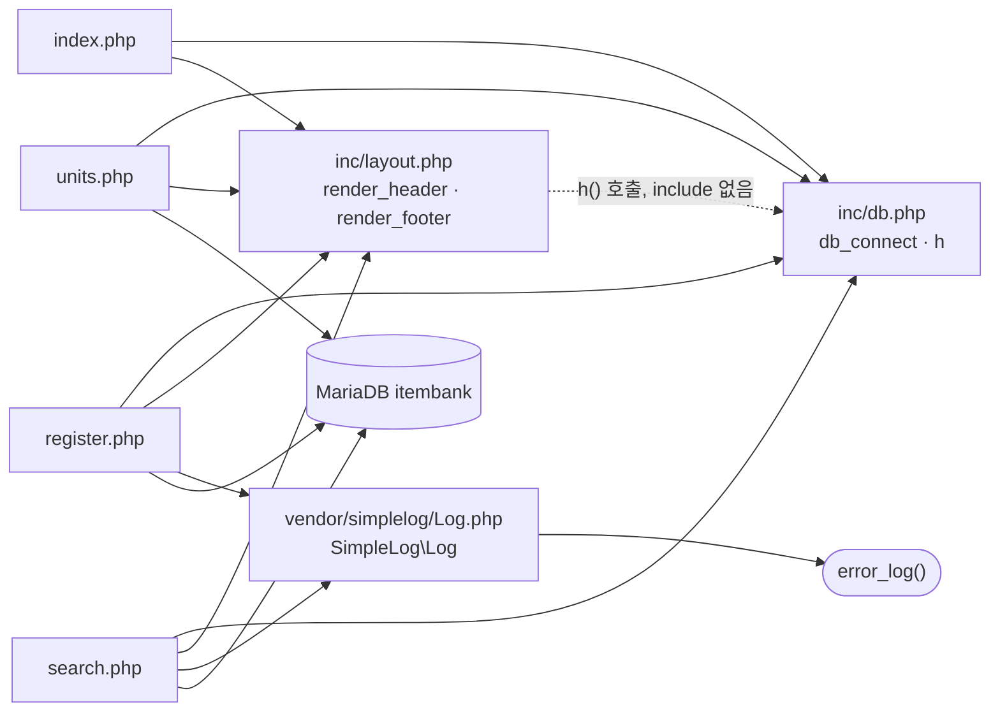

# legacy/item-bank-php 아키텍처

> 분석 범위: 진입점 · 의존 관계. 데이터 흐름 · 비즈니스 규칙은 아직 분석하지 않았다.
> 근거는 `파일:줄번호` 이고 경로는 `legacy/item-bank-php/` 기준이다.

## 모듈 개요

- PHP 7.4 + Apache 위에서 도는 문항 은행 화면 모듈이다(`Dockerfile:1`). DB 접근은 mysqli(`inc/db.php:21`).
- 라우터가 없고 화면 하나가 PHP 파일 하나다: 홈 · 문항 검색 · 문항 등록 · 단원 목록.
- 공통 코드는 `inc/db.php`(DB 연결 · HTML 이스케이프)와 `inc/layout.php`(머리말 · 꼬리말) 두 파일이고, 외부 라이브러리는 `vendor/simplelog/Log.php` 하나다.
- PHP 파일 7개(`vendor` 포함), 1,104줄 중 `search.php` 가 731줄이고, 그중 `buildSearchQuery` 한 함수가 523줄이다.

## 폴더 구조

```
legacy/item-bank-php/
├── Dockerfile               16줄  php:7.4-apache, mysqli 설치, 소스를 /var/www/html 로 복사
├── index.php                14줄  홈(메뉴)
├── search.php              731줄  문항 검색
├── register.php            177줄  문항 등록
├── units.php                48줄  단원 목록
├── inc/
│   ├── db.php               37줄  db_connect(), h()
│   └── layout.php           43줄  render_header(), render_footer()
└── vendor/simplelog/
    └── Log.php              54줄  SimpleLog\Log (error_log 로만 기록)
```

## 진입점

| URL / 화면 | 처음 실행되는 파일 | 부르는 주요 함수 (호출 순서) | 근거 |
|---|---|---|---|
| `/index.php` 홈(메뉴) | `index.php` | `render_header('홈')` → `render_footer()` | `index.php:5`, `index.php:14` |
| `/search.php` 문항 검색 (GET) | `search.php` | `render_header` → `db_connect` → `buildSearchQuery($_GET, $conn)` → `renderSearchForm` → `runSearchQuery` → `renderResultTable` → `render_footer` | `search.php:709`, `:713`, `:722-725`, `:731` |
| `/register.php` 문항 등록 (GET 화면 · POST 저장) | `register.php` | `db_connect` → 단원 · 태그 목록 SELECT → (POST) 검증 → 트랜잭션 INSERT → `Log::info` / `Log::error` → `render_header` → `render_footer` | `register.php:17`, `:27`, `:34`, `:40`, `:85-123`, `:127`, `:177` |
| `/units.php` 단원 목록 | `units.php` | `render_header` → `db_connect` → 단원별 공개 문항 수 SELECT → `render_footer` | `units.php:5`, `:8`, `:16-20`, `:48` |
| `/` (루트) | 미확인 | — | `Dockerfile:1`, `Dockerfile:14` |

메뉴 링크는 `index.php:9-11` 과 `inc/layout.php:10-12` 두 곳에 따로 정의돼 있다(현재 목록은 같다).

## 의존 관계



화살표는 "A → B (A 가 B 를 포함하거나 호출)". 점선은 include 없이 함수만 호출하는 관계다.

### include (require_once)

| A → B | 근거 |
|---|---|
| `index.php` → `inc/db.php`, `inc/layout.php` | `index.php:2-3` |
| `units.php` → `inc/db.php`, `inc/layout.php` | `units.php:2-3` |
| `register.php` → `inc/db.php`, `inc/layout.php`, `vendor/simplelog/Log.php` | `register.php:2-4` |
| `search.php` → `inc/db.php`, `inc/layout.php`, `vendor/simplelog/Log.php` | `search.php:20-22` |

`inc/db.php` · `inc/layout.php` · `Log.php` 는 다른 파일을 include 하지 않는다.

### 함수 호출

| A → B (A 가 B 를 호출) | 근거 | 비고 |
|---|---|---|
| `inc/layout.php` → `inc/db.php` `h()` | `inc/layout.php:17`, `:33` | layout 은 db 를 include 하지 않는다. 호출하는 쪽이 `db.php` 를 먼저 include 해야 하는 숨은 순서 의존 |
| `search.php` · `register.php` · `units.php` → `db_connect()` | `search.php:713`, `register.php:17`, `units.php:8` | `index.php` 는 include 만 하고 호출하지 않는다 |
| 모든 페이지 → `h()` | 예: `units.php:10`, `register.php:20`, `search.php:360` | |
| 모든 페이지 → `render_header` · `render_footer` | `index.php:5,14`, `search.php:709,731`, `register.php:127,177`, `units.php:5,48` | |
| `search.php` 실행부 → `buildSearchQuery` · `renderSearchForm` · `runSearchQuery` · `renderResultTable` | `search.php:722-725` | 모두 같은 파일 안의 함수 |
| `search.php` → `Log::setThreshold` | `search.php:27` | 임계값 `LEVEL_INFO` |
| `search.php` → `Log::debug` | `search.php:103`, `:528` | 임계값이 INFO 라서 기록되지 않는다(`Log.php:45`) |
| `search.php` → `Log::error` | `search.php:537`, `:727` | |
| `register.php` → `Log::info` · `Log::error` | `register.php:115`, `:121` | |
| `Log.php` → `error_log()` | `vendor/simplelog/Log.php:52` | 화면 출력 없음(`Log.php:4`) |

### DB 호출 위치

| 파일 | 근거 |
|---|---|
| `search.php` `buildSearchQuery` (단원 · 태그 선택 목록) | `search.php:125`, `:156`, `:178` |
| `search.php` `runSearchQuery` (건수 · 페이지 조회) | `search.php:577`, `:600` |
| `register.php` | `register.php:27`, `:34`, `:87`, `:92-94`, `:105` |
| `units.php` (상관 서브쿼리를 포함한 SELECT 1회) | `units.php:16-20` |

## 가장 긴 함수 3개

| 파일 | 함수 | 시작–끝 | 줄 수 | 하는 일 |
|---|---|---|---|---|
| `search.php` | `buildSearchQuery` | `:42`–`:564` | 523 | GET 파라미터로 검색 SQL · 건수 SQL · 바인딩 값 · 폼/정렬 링크/경고 HTML 을 한꺼번에 만들어 배열로 돌려준다(`search.php:29-41` 주석 기준) |
| `search.php` | `renderResultTable` | `:647`–`:704` | 58 | 경고 · 요약 · 건수 · 결과 표 · 페이지 이동 링크를 출력한다. 0건이면 "검색 결과가 없습니다"(`:657-659`) |
| `search.php` | `runSearchQuery` | `:571`–`:624` | 54 | 건수 쿼리와 페이지 쿼리를 prepared statement 로 실행해 `total` · `rows` 를 돌려준다(`:623`). 실패하면 RuntimeException |

## 미확인 목록

- `/` 요청 시 `index.php` 가 열리는지. Apache `DirectoryIndex` 설정이 저장소에 없다(`Dockerfile:1`, `Dockerfile:14`).
- `inc/`, `vendor/` 아래 파일이 URL 로 직접 열리는지. 모듈 폴더에 `.htaccess` 가 없고 Apache 설정은 보지 않았다.
- `buildSearchQuery` 내부 로직. `search.php:42-60` 과 grep 에 걸린 줄만 봤고 하는 일은 함수 주석(`search.php:29-41`) 기준이다.
  - 조립한 SQL 에 값을 바인딩으로만 넣는지, 문자열로 이어 붙이는 곳이 있는지도 아직 보지 않았다.
- 동시 등록 시 채번 동작. `register.php:87` 이 트랜잭션 안에서 `SELECT COALESCE(MAX(id), 0) + 1 ... FOR UPDATE` 로 새 ID 를 만든다.
