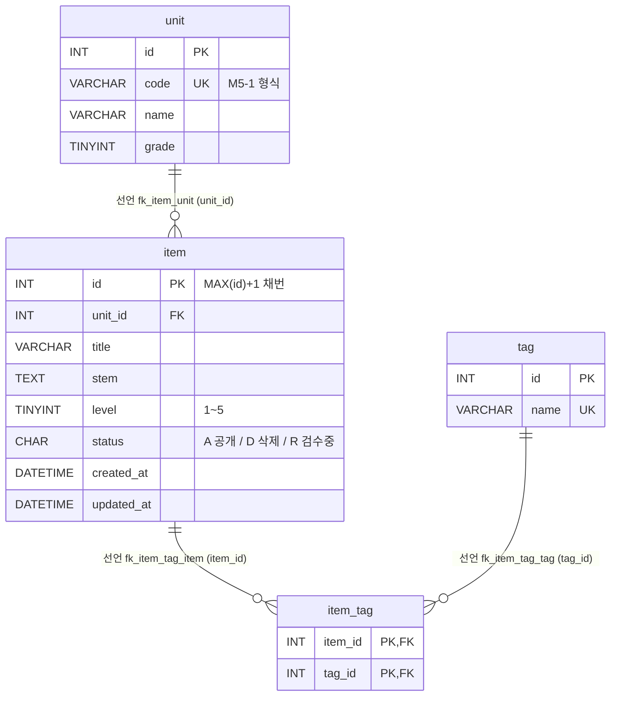
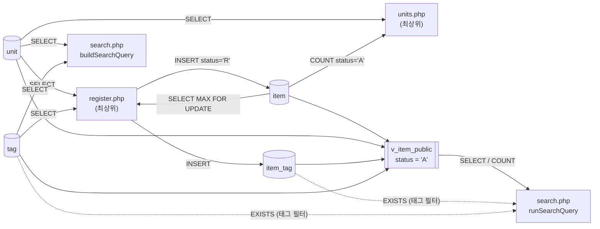

# legacy/item-bank-php 데이터 흐름 (ERD)

> 분석 범위: `legacy/item-bank-php` 가 쓰는 테이블 · 뷰, 그 관계, 읽기 · 쓰기 위치. 진입점 · 의존 관계는 [ARCHITECTURE.md](ARCHITECTURE.md) 를 본다.
> 근거는 `파일:줄번호` 다. PHP 파일은 `legacy/item-bank-php/` 기준, 스키마는 저장소 루트 기준(`db/mariadb/init/01-schema.sql`).
> 모듈은 MariaDB `itembank` 에 `app` 계정으로 붙는다(`inc/db.php:14-18`, `docker-compose.yml:41-45`). 스키마 · 시드는 `db/mariadb/init/*.sql` 이고 PHP 코드에는 DDL 이 없다.

## 요약

- 모듈이 건드리는 것은 테이블 4개(`unit` · `item` · `tag` · `item_tag`)와 뷰 1개(`v_item_public`)다.
- 쓰기는 `register.php` 한 곳뿐이고 INSERT 만 있다(`item`, `item_tag`). 모듈 전체에 UPDATE · DELETE 문이 없다(`grep` 결과 `register.php:87` 의 `FOR UPDATE` 잠금만 걸림).
- 검색(`search.php`)은 `item` 테이블을 직접 읽지 않고 뷰 `v_item_public`(= `status = 'A'` 문항)만 읽는다. 등록은 `status = 'R'` 로 넣는다(`register.php:94`). **R → A 로 바꾸는 코드는 이 모듈에 없다.**
- 코드의 JOIN · 상관 서브쿼리는 모두 스키마에 선언된 외래 키와 같은 경로를 탄다. 외래 키 없이 코드에서만 추정되는 관계는 찾지 못했다.

## 1. 테이블 목록

### 테이블

| 테이블 | 주요 컬럼 | 키 · 제약 | 근거 |
|---|---|---|---|
| `unit` (단원) | `id` INT, `code` VARCHAR(16) (예: `M5-1`), `name` VARCHAR(100), `grade` TINYINT | PK `id`, UNIQUE `code` | `01-schema.sql:11-18` |
| `item` (문항) | `id` INT, `unit_id` INT, `title` VARCHAR(200), `stem` TEXT, `level` TINYINT(1~5), `status` CHAR(1) 기본 `'A'` (A=공개 D=삭제 R=검수중), `created_at` · `updated_at` DATETIME | PK `id`, KEY `unit_id` · `level`, FK `unit_id → unit.id` | `01-schema.sql:20-33` |
| `tag` (태그) | `id` INT, `name` VARCHAR(50) | PK `id`, UNIQUE `name` | `01-schema.sql:35-40` |
| `item_tag` (문항-태그 연결) | `item_id` INT, `tag_id` INT | PK (`item_id`, `tag_id`), FK `item_id → item.id`, FK `tag_id → tag.id` | `01-schema.sql:42-48` |

- `item.id` 는 AUTO_INCREMENT 가 아니다(`01-schema.sql:21`). 등록 시 코드가 `MAX(id)+1` 로 채번한다(`register.php:87`).
- `level` 1~5 범위와 `status` 코드 값은 DB 제약이 아니라 주석으로만 정의돼 있다(`01-schema.sql:25-26`). 범위 검증은 코드 쪽(`register.php:70`)에 있다.

### 뷰

| 뷰 | 컬럼 | 정의 | 근거 |
|---|---|---|---|
| `v_item_public` | `id`, `unit_id`, `unit_code`, `unit_name`, `unit_grade`, `title`, `stem`, `level`, `created_at`, `updated_at`, `tag_names`(태그 이름을 `tag.id` 순으로 쉼표 연결) | `item JOIN unit ON u.id = i.unit_id WHERE i.status = 'A'` + `item_tag JOIN tag` 상관 서브쿼리(`GROUP_CONCAT`) | `01-schema.sql:52-70` |

- 뷰 컬럼에 `status` 는 없다. 검색 결과에 `status` 가 드러나지 않는다.
- 스키마 주석은 "검색 화면과 등록 화면이 모두 이 뷰를 기준으로 삼는다"고 하지만(`01-schema.sql:51`), `register.php` 는 이 뷰를 읽지 않는다. 주석과 코드가 다르다.

### 같은 DB 에 있지만 이 모듈이 쓰지 않는 테이블

`class` · `assignment` · `distribution` · `submission` (`01-schema.sql:75-115`)은 과제 배포 모듈 몫이다. `legacy/item-bank-php` 에서 이 테이블 이름으로 grep 한 결과 SQL 참조가 없다. 이 중 `assignment.unit_id → unit.id` 외래 키가 있어(`01-schema.sql:89`) 이 모듈의 `unit` 을 다른 모듈이 참조한다.

## 2. 테이블 관계

| 관계 | 구분 | 외래 키 근거 | 코드에서 이 관계를 쓰는 곳 |
|---|---|---|---|
| `unit` 1 — N `item` | 선언 | `01-schema.sql:32` | 뷰 JOIN `01-schema.sql:69`, `units.php:17` 상관 서브쿼리 `i.unit_id = u.id` |
| `item` 1 — N `item_tag` | 선언 | `01-schema.sql:46` | 뷰 서브쿼리 `01-schema.sql:67`, `search.php:244-245` (`it.item_id = v_item_public.id`), `register.php:105` INSERT |
| `tag` 1 — N `item_tag` | 선언 | `01-schema.sql:47` | 뷰 서브쿼리 `01-schema.sql:66`, `search.php:244` (`JOIN tag t ON t.id = it.tag_id`) |
| (추정 관계) | — | — | 없음. 코드의 JOIN · 서브쿼리가 모두 위 외래 키 경로와 일치한다 |

`item` ↔ `tag` 는 `item_tag` 를 거치는 다대다다. `search.php` 의 단원 필터는 `unit.id` 가 아니라 뷰의 `unit_code`(= `unit.code`)로 거른다(`search.php:118`).

## 3. 읽기 · 쓰기 위치

"함수" 칸이 `(최상위)` 이면 함수 밖 페이지 본문 코드다. SQL 은 `search.php` 에서 `buildSearchQuery` 가 문자열로 만들고 `runSearchQuery` 가 실행한다.

### `unit`

| 구분 | 파일 · 함수 | SQL 요지 | 근거 |
|---|---|---|---|
| 읽기 | `search.php` `buildSearchQuery` | `SELECT name, grade FROM unit WHERE code = ?` (검색 요약에 단원 이름 표시, 없는 코드면 경고) | `search.php:125` |
| 읽기 | `search.php` `buildSearchQuery` | `SELECT code, name, grade FROM unit ORDER BY grade, code` (단원 선택 목록) | `search.php:156` |
| 읽기 | `register.php` (최상위) | `SELECT id, code, name FROM unit ORDER BY grade, code` (선택 목록 + 단원 검증 기준) | `register.php:27`, 검증 `:60-68` |
| 읽기 | `units.php` (최상위) | `SELECT u.id, u.code, u.name, u.grade, (상관 서브쿼리) FROM unit u ORDER BY grade, code` | `units.php:16-20` |
| 읽기(간접) | `search.php` `runSearchQuery` | 뷰 `v_item_public` 을 통해 `unit.code` 를 읽음 | `search.php:577`, `:600` |
| 쓰기 | 없음 | — | — |

### `item`

| 구분 | 파일 · 함수 | SQL 요지 | 근거 |
|---|---|---|---|
| 읽기 | `register.php` (최상위, 트랜잭션 안) | `SELECT COALESCE(MAX(id), 0) + 1 AS next_id FROM item FOR UPDATE` (채번 · 잠금) | `register.php:85-90` |
| 읽기 | `units.php` (최상위) | 상관 서브쿼리 `SELECT COUNT(*) FROM item i WHERE i.unit_id = u.id AND i.status = 'A'` | `units.php:17` |
| 읽기(간접) | `search.php` `runSearchQuery` | 뷰 `v_item_public` 을 통해 `status = 'A'` 문항만 | `search.php:577`, `:600` |
| 쓰기 INSERT | `register.php` (최상위, 트랜잭션 안) | `INSERT INTO item (...) VALUES (?, ?, ?, ?, ?, 'R', NOW(), NOW())` | `register.php:92-101` |
| 쓰기 UPDATE · DELETE | 없음 | 상태 변경(R→A, A→D) · 수정 · 삭제 코드가 모듈에 없다 | 모듈 전체 grep |

- 등록 시각은 DB 의 `NOW()` 다(`register.php:94`). 주입된 시계를 쓰지 않는다.

### `tag`

| 구분 | 파일 · 함수 | SQL 요지 | 근거 |
|---|---|---|---|
| 읽기 | `search.php` `buildSearchQuery` | `SELECT name FROM tag ORDER BY id` (태그 선택 목록) | `search.php:178` |
| 읽기 | `search.php` `buildSearchQuery` → `runSearchQuery` 실행 | 태그 필터 `EXISTS (SELECT 1 FROM item_tag it JOIN tag t ... WHERE t.name = ?)` | 조립 `search.php:244-247`, 실행 `:577`, `:600` |
| 읽기 | `register.php` (최상위) | `SELECT id, name FROM tag ORDER BY id` (선택 목록 + 태그 검증 기준) | `register.php:34`, 검증 `:74-81` |
| 읽기(간접) | `search.php` `runSearchQuery` | 뷰의 `tag_names` | `search.php:521`, `01-schema.sql:64-67` |
| 쓰기 | 없음 | — | — |

### `item_tag`

| 구분 | 파일 · 함수 | SQL 요지 | 근거 |
|---|---|---|---|
| 읽기 | `search.php` `buildSearchQuery` → `runSearchQuery` 실행 | 태그 필터 EXISTS 서브쿼리 | 조립 `search.php:244-245`, 실행 `:577`, `:600` |
| 읽기(간접) | `search.php` `runSearchQuery` | 뷰의 `tag_names` | `01-schema.sql:64-67` |
| 쓰기 INSERT | `register.php` (최상위, 트랜잭션 안) | `INSERT INTO item_tag (item_id, tag_id) VALUES (?, ?)` 를 선택한 태그 수만큼 | `register.php:104-113` |
| 쓰기 UPDATE · DELETE | 없음 | — | — |

### `v_item_public` (뷰)

| 구분 | 파일 · 함수 | SQL 요지 | 근거 |
|---|---|---|---|
| 읽기 | `search.php` `runSearchQuery` | 건수: `SELECT COUNT(*) AS cnt FROM v_item_public WHERE ...` | 조립 `search.php:526`, 실행 `:577` |
| 읽기 | `search.php` `runSearchQuery` | 페이지: `SELECT id, title, unit_code, level, tag_names, created_at FROM v_item_public WHERE ... ORDER BY ... LIMIT 20 OFFSET n` | 조립 `search.php:521-525`, 실행 `:600` |

`search.php` 가 뷰에서 쓰는 컬럼: SELECT `id` · `title` · `unit_code` · `level` · `tag_names` · `created_at`(`:521`), WHERE `title` · `stem`(`:98`) · `unit_code`(`:118`) · `level`(`:215`, `:218`, `:226`) · `id`(`:245`), ORDER BY `id` · `title` · `unit_code` · `level` · `created_at`(`:279-325`). 뷰의 `unit_id` · `unit_name` · `unit_grade` · `updated_at` 은 이 모듈에서 읽지 않는다.

### 데이터 흐름 요약

## 4. 미확인

- **`item.status` 를 `R` → `A`(검수 완료)나 `D`(삭제)로 바꾸는 주체.** 이 모듈에는 UPDATE 가 없다. 다른 모듈 · 운영 스크립트 · 수작업 중 무엇인지 확인하지 못했다. 그래서 등록한 문항이 검색에 나오는 경로가 이 모듈 안에서는 닫히지 않는다.
- **`item.updated_at` 을 갱신하는 주체.** INSERT 때 `NOW()` 로 한 번 채우는 것(`register.php:94`) 외에는 없다.
- **`item.id` 채번의 동시성.** `MAX(id)+1 ... FOR UPDATE`(`register.php:87`)가 동시 등록에서 충돌 없이 동작하는지는 실행해 보지 않았다. 트랜잭션 격리 수준 설정도 저장소에서 보지 않았다.
- **`register.php` 가 `level` 을 `'iissi'` 로 바인딩하는 점**(`register.php:98`): `title` · `stem` 이 `s`, `level` 이 `i` 로 순서는 맞아 보이지만 실행해서 확인하지 않았다.
- **`item_tag` INSERT 실패 시 동작.** 같은 태그 ID 가 `tags[]` 에 두 번 오면 `validTagIds` 에 중복으로 들어가(`register.php:75-80`) PK 충돌 → 롤백될 것으로 보이나 실행해 확인하지 않았다.
- **외래 키 없이 코드에서만 쓰는 관계.** 찾지 못했다(추정 관계 없음). `search.php` `buildSearchQuery` 523줄 중 SQL 조각이 들어가는 줄(`$where` · `$orderBy` · `$select` · `$from` 조립)만 grep 으로 확인했고, 나머지 폼 · 링크 HTML 조립부는 읽지 않았다.
